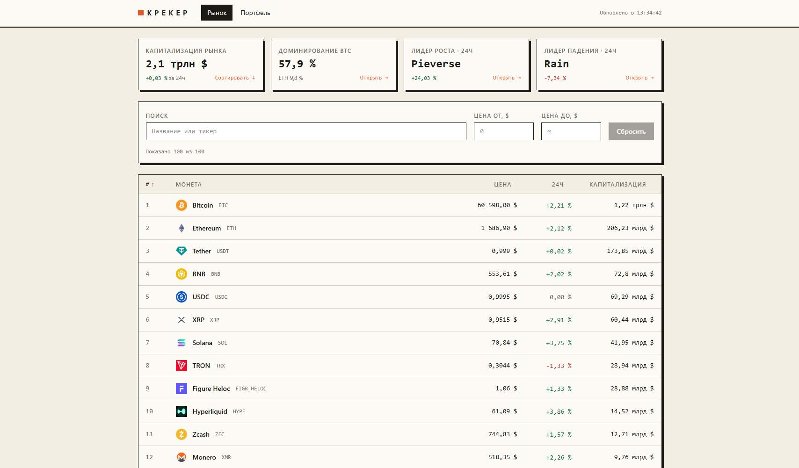
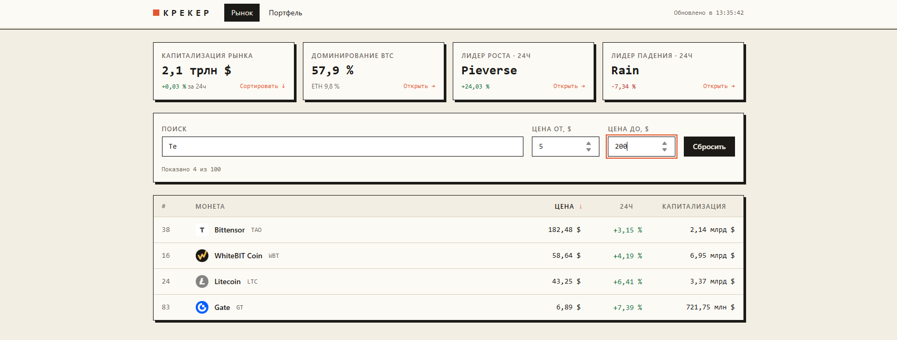
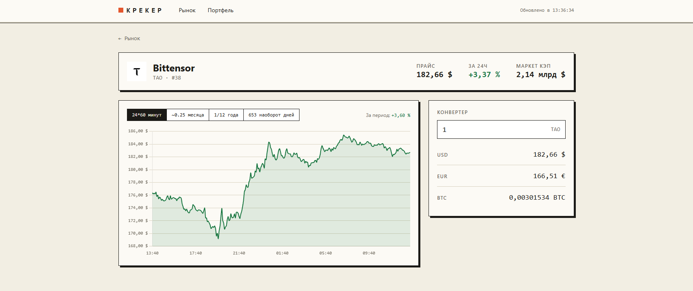
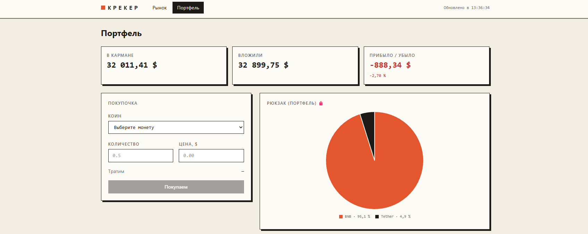
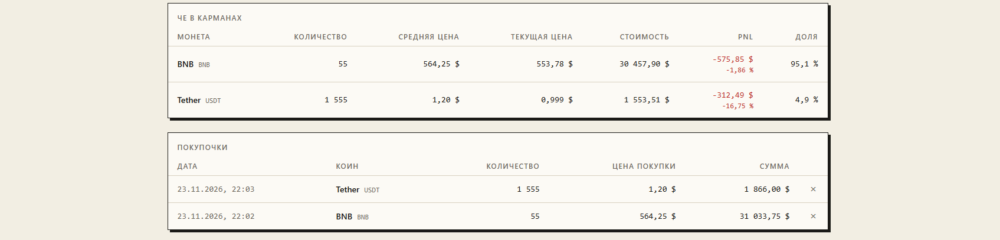
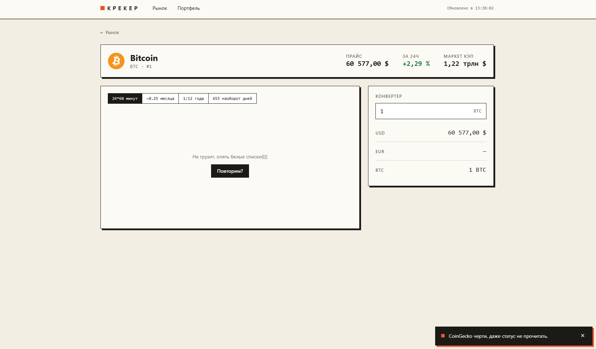

## Задание

Продемонстрировать навыки проектирования SPA на базе современного фреймворка, интеграции с внешними API, управления глобальным состоянием, оптимизации сетевых запросов и обеспечения отказоустойчивости интерфейса.

## Архитектура и стек технологий

1. Выберите фреймворк **React**/~~Vue/Angular/Svelte~~
2. Интерфейс нужно создать самостоятельно, главное требование - он должен быть простым и понятным. Разрешено использовать **Tailwind CSS** или ~~Bootstrap~~ для ускорения верстки, но вся логика должна быть реализована строго на JS.
3. Для отрисовки графиков используйте одну из сторонних библиотек (например, **Chart.js** или ~~ApexCharts~~).
4. Данные для отрисовки нужно взять с бесплатного API (**CoinGecko API** или ~~CoinCap API~~).
5. Обязательно используйте глобальное хранилище (**Redux Toolkit**/~~Zustand/Pinia/NgRx~~). Локальное состояние компонентов (useState, ref) разрешено только для UI-интерфейсов (открыто/закрыто модальное окно и тд.).
6. Бизнес-логика (запросы к API, расчет PnL, и тд.) должна быть строго отделена от UI-компонентов. Вся асинхронная логика должна находиться в Actions/Сustom Hooks. Приложение должно корректно обрабатывать состояния загрузки данных (Loading state с использованием Skeleton-компонентов) и пустые результаты поиска (Empty state).

## Требования:

1. Приложение должно работать как Single Page Application. Переключение между страницами (Главная, Детали монеты, Портфель) должно происходить без перезагрузки.
2. Главная страница должна представлять собой динамическую таблицу с топ-100 криптовалют и состоять из полей: ранг, название, текущая цена, изменение за 24 часа (зеленый/красный цвет текста), капитализация. Если каких-то данных в API нет, эти данные отображать не нужно.
3. Необходимо дополнительно на главной странице реализовать панель с поиском и фильтрацией: поиск по названию, фильтрация по диапазону цен, сортировка по клику на заголовки столбцов (вверх/вниз) - всё это должно происходить без перезагрузки страницы.
4. Добавить интерактивные виджеты на главной: 3-4 карточки сверху таблицы с глобальными метриками рынка (общая капитализация, изменение за сутки и тд. можете выбрать самостоятельно).
5. Страница с монетой должна открываться по динамическому URL (например, \#coin?id=bitcoin или /coin/bitcoin) и содержать: исторический график с отображением изменения цены монеты; переключатель таймфреймов (1 день, 7 дней, 30 дней, 1 год); быстрый пересчет (конвертер) в USD/EUR/BTC.
6. Страница инвестиционного портфеля должна содержать: форму добавления транзакций (монета, количество, цена покупки), пользователь выбирает монету, вводит количество и цену; отображение структуры портфеля в виде круговой диаграммы (Pie Chart) в процентном соотношении; расчет текущей стоимости портфеля и общей прибыли/убытка (PnL) на основе актуальных цен из API. Добавить сохранение всех данных портфеля в localStorage.
7. Если приложение открыто в двух вкладках браузера, добавление транзакции в портфель в одной вкладке должно мгновенно обновлять данные во второй вкладке без ручной перезагрузки (реализовать через StorageEvent или BroadcastChannel API).
8. Написать свою функцию debounce для поисковой строки. Запросы к API и фильтрация массива не должны срабатывать на каждое нажатие клавиши (задержка 300 мс).
9. Реализовать автообновление (Polling) данных, т.е. периодический фоновый опрос API каждые 30–60 секунд с помощью setInterval. При обновлении данных должен отображаться индикатор обновления (Spinner/Progress bar) и таблица должна плавно обновляться, не сбрасывая текущий скролл пользователя.
10. Поскольку бесплатные API имеют жесткие лимиты на количество запросов в минуту (Rate Limits), приложение должно корректно обрабатывать ошибку 429 Too Many Requests и сетевые сбои. Приостановка работы API не должна приводить к падению приложения, нужно показать пользователю кастомное модальное окно или уведомление об ошибке.
11. При частом обновлении данных (например, при поиске) запрещено делать полную замену document.body.innerHTML = ..., так как это сильно бьет по производительности.
12. Реализовать защиту от XSS-атак. При вставке строк (названий монет, полученных из API) использовать безопасный textContent или innerText вместо innerHTML.

## Скриншоты

<!-- 

  

  

  

  

  

  

 -->
